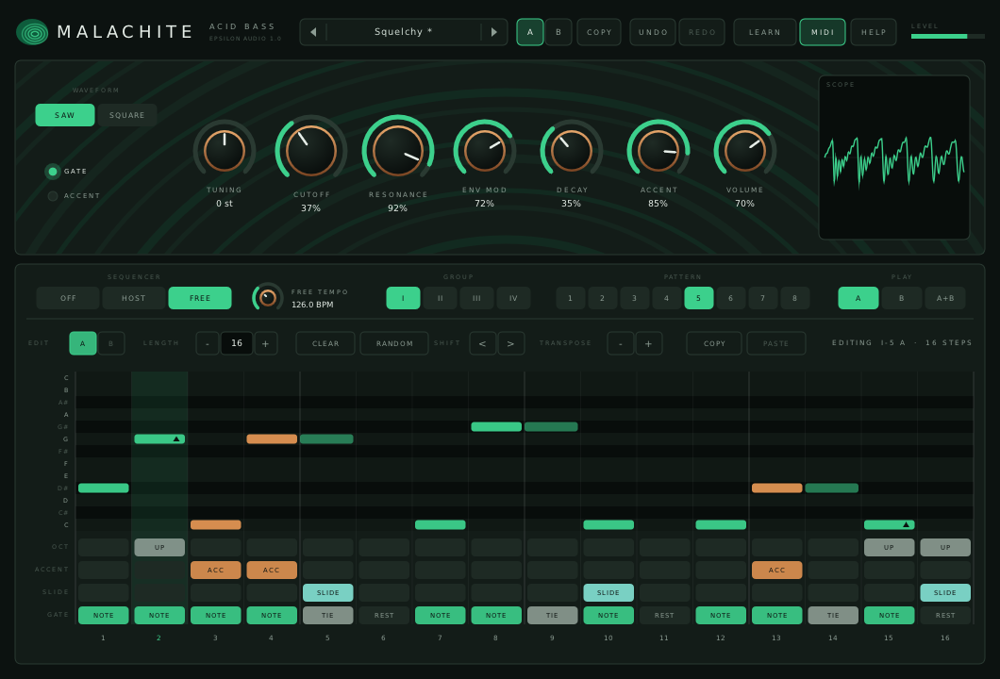
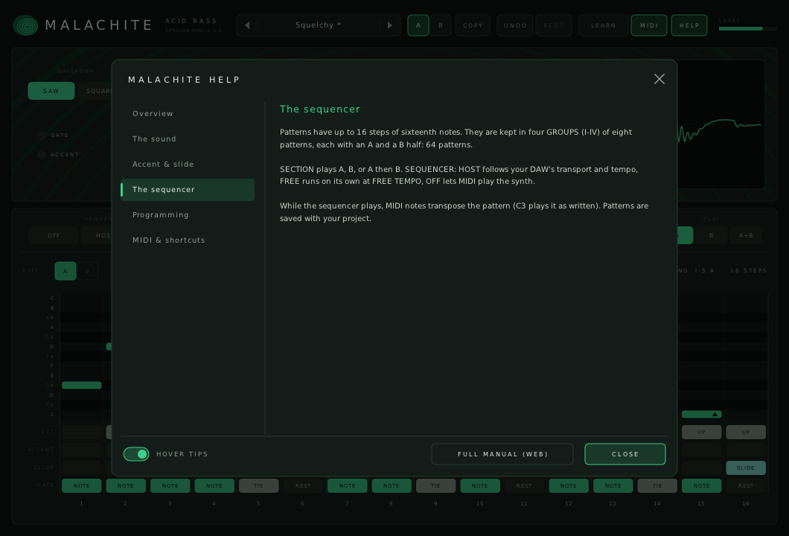

# Malachite

**An acid bass synthesizer with a 16-step pattern sequencer, accent and slide, for macOS, Windows and Linux (VST3 · AU · CLAP · VST2).**

Part of **[Epsilon Audio](https://github.com/natehouk/epsilon-plugins)**, a family of free, open-source plugins: Monolith, Caldera, Obsidian, Strata, Basalt, Gneiss, Mica, Flint, Granite, Magma, Schist, Slate, Talc, Geode and Malachite.



Malachite is a clean-room design with the feature set of the Roland TB-303 (1981): one oscillator, a squelchy resonant filter, accent and slide, and a pattern sequencer. It was written from scratch, working only from public descriptions of the instrument's features and behaviour. Its interface is an original design, not a copy of the hardware's panel. No Roland code, firmware, samples, artwork or trademarks were used.

It is part of a family of plugins:
- [Monolith](https://github.com/natehouk/monolith) (synth)
- [Caldera](https://github.com/natehouk/caldera) (filter)
- [Obsidian](https://github.com/natehouk/obsidian) (polysynth)
- [Strata](https://github.com/natehouk/strata) (tape delay)
- [Basalt](https://github.com/natehouk/basalt) (live dual filter)
- [Gneiss](https://github.com/natehouk/gneiss) (compressor)
- [Mica](https://github.com/natehouk/mica) (equalizer)
- [Flint](https://github.com/natehouk/flint) (small filter)
- [Granite](https://github.com/natehouk/granite) (limiter)
- [Magma](https://github.com/natehouk/magma) (multiband distortion)
- [Schist](https://github.com/natehouk/schist) (multiband dynamics)
- [Slate](https://github.com/natehouk/slate) (gate / expander)
- [Talc](https://github.com/natehouk/talc) (de-esser)
- [Geode](https://github.com/natehouk/geode) (reverb)
- **Malachite**, the banded green copper stone that fizzes in acid

## Download

Get the latest build from [**Releases**](../../releases):

| Platform | File | Contains |
|---|---|---|
| macOS 10.13+ (Apple Silicon + Intel) | `Malachite-macos-universal.zip` | VST3, AU, CLAP, manual |
| Windows x64 | `Malachite-windows-x64.zip` | VST3, CLAP, VST2, manual |
| Linux x64 | `Malachite-linux-x64.zip` | VST3, CLAP, VST2, manual |

### Install

| Platform | Copy | To |
|---|---|---|
| macOS | `Malachite.vst3` / `Malachite.component` / `Malachite.clap` | `~/Library/Audio/Plug-Ins/VST3` / `Components` / `CLAP` |
| Windows | `Malachite.vst3` (folder) / `Malachite.clap` | `C:\Program Files\Common Files\VST3\` / `CLAP\` |
| Linux | `Malachite.vst3` / `Malachite.clap` | `~/.vst3/` / `~/.clap/` |

**macOS:** builds are notarized once the project's Apple signing credentials are set up. Until then they are ad-hoc signed; after copying, run:

```
xattr -dr com.apple.quarantine ~/Library/Audio/Plug-Ins/*/Malachite*
```

## Features

**The sound**
- One band-limited oscillator: **saw** or **square**, with tuning of ±12 semitones. The oscillator and filter run at twice the sample rate, with anti-aliased saturation, so high notes stay clean.
- A resonant **4-pole low-pass filter** that squelches hard but never self-oscillates, with Cutoff, Resonance, Env Mod and Decay (0.2-2.5 s).
- A fixed amp envelope: quick attack, long fade while the note is held.
- **Accent:** louder, with a stronger, snappier filter sweep. Back-to-back accents charge up and ramp the filter, more so with high resonance.
- **Slide:** a fixed-time glide into the next note, without a new attack.

**The sequencer**
- **64 patterns**: four groups of eight, each with an A and a B half. Play A, B, or A then B.
- Up to **16 steps** per pattern, each with a note (C to C), octave up or down, accent, slide, and note, tie or rest.
- Follows the **host tempo and transport**, or runs free at its own tempo.
- **MIDI transposes** the running pattern.
- A step grid for programming, plus length, clear, random, shift, transpose, and copy/paste between slots.
- Group, pattern and section can be automated; patterns are saved with the project.
- Ten original example lines in group I.

**Workflow**
- Or switch the sequencer off and play it from **MIDI**: high velocity accents, overlapping notes slide.
- Scope, gate and accent lights, output level.
- A/B (patterns included) with copy, undo/redo for every edit (patterns included), MIDI Learn.
- Smoothed, sample-accurate automation.
- Resizable interface.
- **22 factory sound presets** in four categories, plus user presets. Presets change the sound only, never your patterns.
- **Hover tips** everywhere, a **HELP window**, and a **[full manual](docs/MANUAL.md)** (also in every release zip as `Malachite-Manual.html`).



### Compared with the TB-303 (1981)

| TB-303 | Malachite |
|---|---|
| One oscillator, saw or square, with tuning | ✓ |
| Resonant low-pass filter that doesn't self-oscillate; cutoff, resonance, env mod, decay | ✓ |
| Fixed amp envelope | ✓ |
| Accent (level and filter), building up over consecutive accents | ✓ |
| Slide (portamento into the next note) | ✓ |
| 16-step patterns with note, octave up/down, accent, slide, and note/tie/rest | ✓ |
| Variable pattern length | ✓ |
| 64 patterns: 4 groups × 8 patterns × A/B | ✓ |
| Pattern chaining | A then B |
| Tracks (songs of chained patterns) | Not included: automate GROUP / PATTERN / PLAY in your DAW |
| Separate pitch-mode and time-mode entry | Replaced by a step grid (each step has its own note and gate) |
| Sync and CV/gate jacks | Host tempo and transport; MIDI notes play the synth or transpose the sequencer |
| Panel design | Original design |

## Build from source

The plugin is built on [DPF](https://github.com/DISTRHO/DPF):

```
git clone --recursive https://github.com/DISTRHO/DPF.git dpf
make -C plugins/Malachite                    # Linux / macOS (macOS also builds the AU)
make -C plugins/Malachite WINDOWS=true CC=x86_64-w64-mingw32-gcc CXX=x86_64-w64-mingw32-g++
```

GitHub Actions builds all three platforms on every push. The macOS build is universal. It is signed and notarized when the Developer ID secrets are set (`MACOS_CERT_P12`, `MACOS_CERT_PASSWORD`, `NOTARY_KEY`, `NOTARY_KEY_ID`, `NOTARY_ISSUER`), and ad-hoc signed otherwise. A `v*` tag, or a release published on GitHub, attaches the zips to that release.

## Tests

```
cd tests
g++ -O2 -std=c++11 features.cpp -o features && ./features   # waveforms, pitch and tuning, cutoff, resonance (no self-oscillation), decay,
                                                            # accent and accent build-up, slide, sequencer timing with notes, rests and ties,
                                                            # host sync and stop, length, A+B chaining, MIDI transpose, pattern storage, presets
g++ -O2 -std=c++11 fuzz.cpp -o fuzz && ./fuzz               # random settings, patterns, MIDI and transport jumps at 44.1-192 kHz: always finite
g++ -O2 -std=c++11 presets.cpp -o presets && ./presets      # every sound preset plays the factory pattern: level and peak
g++ -O3 -std=c++11 bench.cpp -o bench && ./bench            # CPU
```

Malachite takes about 0.9% of one CPU core.

Release checks:
- Steinberg's VST3 validator passes 47/47.
- The interface is exercised with scripted input: pattern editing, tools, presets, knobs, tips and help, with the sequencer running.

## Source layout

| File | Contents |
|---|---|
| `plugins/Malachite/MalachiteEngine.hpp` | All DSP and the sequencer: oscillator, filter, envelopes, accent, slide, patterns and their text form. Header-only |
| `plugins/Malachite/ParamDefs.hpp` | Parameter table, labels, value mapping |
| `plugins/Malachite/Presets.hpp` | Factory sound presets |
| `plugins/Malachite/UserPresets.hpp` | User preset files |
| `plugins/Malachite/Help.hpp` | Hover tip text and in-plugin help pages |
| `plugins/Malachite/MalachitePlugin.hpp/.cpp` | Plugin wrapper: parameters, patterns (plugin state), host transport, MIDI, MIDI Learn |
| `plugins/Malachite/MalachiteUI.cpp` | Custom vector interface (NanoVG) |
| `docs/MANUAL.md` | User manual (`Malachite-Manual.html` is generated from it with pandoc) |

## License

[MIT](LICENSE). Built with [DPF](https://github.com/DISTRHO/DPF) and its bundled NanoVG, which are under the ISC license. `plugins/Malachite/ResizeHandle.hpp` comes from DPF's examples and keeps its ISC notice.

"Roland" and "TB-303" are trademarks of Roland Corporation. Malachite is not affiliated with or endorsed by Roland.
